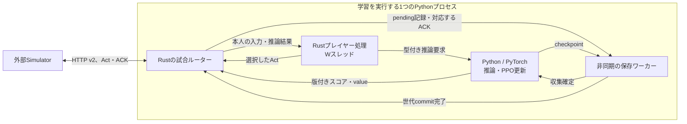

# Rustイベント駆動プレイヤーの設計調査

2026-11-19。対象は Bots `0044ce285ba72a9a6c24e7b7329d0f5cbede52f7` の共有MLP学習。比較計測があるHPO Model4を中心に、通常PPO Model3の接続点も調べた。本資料は設計の入力であり、新しい実行方式の採択・性能検証は今後の作業となる。

## 設計の前提

ユーザー指定は、学習を実行するPythonプロセスを1つにすること、全ての進行中の試合を同じRustランタイムに載せること、各プレイヤーを論理的に分離すること、イベントを処理するワーカースレッド数を設定できること。PythonがPyTorchによる推論・PPO更新を担当し、Rustがプレイヤー処理の大部分を担当する。保存は非同期で進める。Simulatorは引き続き外部サーバーとしてゲーム規則・合法性判定・状態遷移を所有する。

Simulatorの参照版は `072dabbca1458c9526897781d2fd64edeeb4f9ca`、仕様07のSHA-256は `8e5223b45a6e8c4c80e272736ed97b9e271136c939eca74427a035ddfdbfcac2`。新方式の設計記録には今回の「論理分離でよい」という明示条件も記録する。過去の実行は当時のプロセス分離・証跡・版で読む。[Simulator §21.1](https://github.com/Percy08-dev/GodFieldSimurator/blob/072dabbca1458c9526897781d2fd64edeeb4f9ca/docs/spec/07-external-interfaces-adapters.md#shared-batch-inference)・[現行の責務と依存関係](../architecture.md)・[ADR0053](../adr/0053-mlp-shared-batch-inference.md)

調査上の判断は、CPUのデータ受け渡しと同一プロセス内のMLP推論を既存部品で試せること、実装規模を左右するのは**オンライン候補生成の互換性、保存完了の境界、GPU実行の終了・再開証跡**であること。下図は責務の候補で、保存をPythonとRustのどちらが実行するかは未決。



Tokio／固定ワーカーの比較条件、PyO3のGIL、asyncio連携の版と既知issue、終了手順は[公式資料との照合記録](rust-player-runtime-tokio-pyo3-notes.md)にまとめた。

## どこにコストがあるか

同一の幅192、seed 17、32試合×2更新、4 epochs、minibatch 128の既存測定から抜粋した。PSSはプロセス間で共有ページを按分したメモリ量。参加者欄は、プロセス群全体のPSSが最大だった**同じサンプル**で集計した。

| 現行の条件 | 収集速度（合計） | 推論往復p95（第1／第2収集） | 全体のピークPSS | その時点のCPU参加者 |
| --- | ---: | ---: | ---: | ---: |
| 8並列・上限8・4 ms | 1.158試合/秒 | 220／207 ms | 8.84 GiB | 16プロセス、計4.90 GiB |
| 16並列・上限16・2 ms | 1.182試合/秒 | 382／375 ms | 13.56 GiB | 32プロセス、計9.60 GiB |

参加者のPSSには試合ごとに今後も必要な状態や作業領域が入るため、その全量を削減見込みにはできない。推論往復にはキュー、変換、転送、既存の行単位MLP計算と返送が入る。各区間の寄与は未分解。これに対して、直近8条件・16更新では経験バッチのlearnerへの送信区間の中央値は32 ms（範囲23〜171 ms）、数値更新ループは3.43〜5.55秒。大きな数値配列は既にsealed memfdのFDを渡してmmapで参照している。収集側での数値化・保存、受信後の検証は送信区間の外にある。[待機時間の測定](../../runs/ppo-shared-wait-sweep-v1/report.md)・[共有MLPの比較と監査](../verification/ppo-shared-inference.md)・[learnerへの受け渡し](../../src/gf_training/hpo_owned_process.py)

保存にも2種類の時間がある。上記2条件の4収集では、グループの書き込み処理の計時合計が1.18〜1.43秒、収集末尾のSQLite checkpointと封印の区間が0.92〜1.09秒。並列区間を含むため、この合計を収集実時間から差し引いても高速化率にはならない。16並列の別試行では、4 GiBの収集・記録予算を超えて収集が失敗した。失敗時の要求は209,780,736 bytes、既に計上済みの量は4,118,782,740 bytesであり、いずれも管理上の予約量。キューに入った項目数だけでは保持量や物理RAMは求まらない。[保存予算の実例](../../runs/ppo-shared-wait-sweep-v1/failed-c16-storage-adjustment.json)

## 現行の実装から引き継げるもの

| 領域 | 確認した実装と新方式への影響 |
| --- | --- |
| HTTPと試合進行 | 現行は席替えペア単位にSimulatorとHTTPクライアントを持ち、ペア内の試合を順番に実行する。テストサーバーの同一性・seed・仕様・catalogを確認し、手番プレイヤーのObservation、ページ付きEvents、同じrevisionのActionOptionsを使う。固定版SimulatorのRust `Client` にはcreate/join/state/events/actがある。公開メソッド一覧ではBotsが使うActionOptions・Replay・Deleteの全経路を満たさない。Rust HTTPを選ぶ場合はこの差分と再接続時のattestationを扱う。Simulator内部のengineへの直結は不要。[試合ループ](../../src/gf_simulator_client/environment.py)・[現行HTTP契約](../../src/gf_simulator_client/http.py)・[固定版Rust Client](https://github.com/Percy08-dev/GodFieldSimurator/blob/072dabbca1458c9526897781d2fd64edeeb4f9ca/src/client.rs) |
| 候補生成・方策 | 現行のオンライン生成器はPythonの `PublicCandidateGeneratorV3.generate_game`。候補表・順序・探索RNG・打切り理由・ポリシー版が記録される。RustのDTO、記録読取、トークン生成、Fixture/Actor64の検証コードは移植時の比較対象になる。現行nativeのcapabilityはオンラインの候補生成器やゲーム実行権限を表さない。[生成器](../../src/gf_common/diverse_actions.py)・[参加者の境界チェック](../../src/gf_simulator_client/card_instance_worker.py)・[nativeのトークン比較](../../tests/test_card_instance_native_fixture_tokens.py) |
| CPUスレッド | `native/Cargo.toml` はPyO3 0.30.1、rust-numpy 0.30.0、ndarray 0.17.2、Rayon 1.12.0を固定。オフライン解析の `with_pool` にスコープ付きプール、設定数、join、部分起動失敗のテストがある。既存のworkers=1は呼出側で実行するため、オンラインで同じ挙動を採るならI/Oを進めるスレッドを長時間占有しないことを確認する。Bots nativeにはTokio・HTTPクライアントの直接依存はない。HTTPをPythonに残す案とRust側へ移す案で必要依存が異なる。[Cargo設定](../../native/Cargo.toml)・[既存プール](../../native/src/episode_pool.rs)・[Rayonのスレッド数設定](https://docs.rs/rayon/1.12.0/rayon/struct.ThreadPoolBuilder.html) |
| PyTorch | FP32のスコア計算と不変checkpointのレジストリは既に独立している。現在は仲介とGPU推論が別プロセスで、数値をJSON化し、受信後にTorch Tensorへ構築する。返答の確率・logprobもリスト化される。現行の共有MLPは要求をまとめて転送し、候補の正規化と演算は各行内で行う。スレッド化だけではこのGPU演算方式は変わらない。[数値入力と演算](../../src/gf_models/shared_numeric.py)・[仲介](../../src/gf_simulator_client/shared_bootstrap.py)・[レジストリ](../../src/gf_models/shared_registry.py) |
| Pythonプロセス群 | 参加者・仲介・GPU推論に加え、HPOのlearnerとSQLite writerも別プロセス。writerは明示的に `sys.executable -I -m gf_training.group_pack_worker` を起動する。新方式ではPyTorchへの直接呼出、同一プロセス内の保存所有者、起動・停止の新しい証跡が必要になる。Torchの決定論・スレッド数・CUDA設定はプロセス全体に効く。現行の参加者起動処理はargv・環境変数を変更し、CUDAを隠して未初期化を要求する。CUDA learnerと同じプロセスに置く場合は専用のスレッド入口が必要になる。[現行bootstrap](../../src/gf_simulator_client/shared_actor_bootstrap.py)ネットワーク初期化はdefault RNGの状態を退避・seed・復元するので、learnerとの同時変更を防ぐ。[learner](../../src/gf_training/hpo_owned_process.py)・[writer](../../src/gf_training/group_pack_writer.py)・[Torch設定](../../src/gf_models/torch_runtime.py)・[ネットワーク初期化](../../src/gf_models/structured_network.py) |

## Rust／PyTorchのデータ境界

**実機で確認した範囲。** 現行ソースとCargo.lockのハッシュが一致する `gf_native`、Python 3.14.10（GIL有効）、NumPy 2.5.4、Torch 2.14.1+cu132のCPUで既存の `native-turn-v1-win-n1` fixtureを読んだ。`int64` の非空Rust配列で、NumPyのアドレス、`torch.from_numpy` の `data_ptr()`、TensorDict内のTensorのアドレスが一致した。RustセッションをcloseしPython側の元変数を解放しても、Tensorが残る間は参照値が一致し、最後のTensorを解放すると元配列が回収された。nativeの配列公開時にもポインタ一致を検査している。[配列所有者](../../native/src/lib.rs)・[native側のコピー検出](../../native/src/telemetry.rs)・[今回の確認結果](../../runs/rust-player-design-research/boundary.json)

この経路ではNumPyビューが読取専用なので、PyTorchが書込み非対応の警告を出した。公開する演算を読取専用に限定するか、Tensorへ変更可能なバッファの所有権を移すかをAPIで決める必要がある。誤ったin-place演算やRust側の早すぎる再利用を防ぎ、非同期H2Dを使う場合はCUDA側の転送完了まで元バッファを保持する。今回ポインタを確認したfixtureの `state_numerics` はint64で、現在の共有MLPがこのフィールドを入力するときはfloat32を要求する。最終dtypeでRustから出力する方法と、変換を伴う方法のコストを区別する。CPUでの参照共有と、離散GPUへの転送・バッチ構築は別々に計測する。GIL有効環境では、Python APIを使わないCPU処理・待機を `Python::detach` 相当で切り離し、ワーカーからの細粒度なPythonコールを避ける。[PyTorch from_numpy](https://docs.pytorch.org/docs/2.14/generated/torch.from_numpy.html)・[Tensor.to](https://docs.pytorch.org/docs/2.14/generated/torch.Tensor.to.html)・[PyO3のGILと性能](https://pyo3.rs/main/performance.html)

**どの形状を試すか。** 監査済みC4/B4の2世代のNumeric6マニフェストをupdateのSHAと照合し、学習者側628判断（331＋297）の配列形状を再集計した。入力バイト数は現行 `numeric_row → tensor_row` の21フィールド、dtype、候補参照18列から算出したCPUテンソルの要素量。出力はFP32のlogprobとprobabilityを候補ごとに1つずつ、valueを1つとして算出した。制御メタデータ、Pythonオブジェクト、JSON、デバイス転送時間は含まない。

| 1要求あたり | 最小 | 中央値 | p95 | 最大 |
| --- | ---: | ---: | ---: | ---: |
| 候補数 | 1 | 9 | 約1,131 | 2,723 |
| 新規区間イベント数 | 0 | 7 | 12 | 21 |
| CPU入力の要素バイト数 | 9,366 | 12,010 | 約226,520 | 531,958 |
| スコア返答の要素バイト数 | 12 | 76 | 約9,052 | 21,788 |

実ゲームの全相手や設定上限を覆う母集団ではない。設定上は候補32,768、系列要素18、区間イベント4,096まであり、別途最大形状テストが要る。Numeric6にはint64の数値列やuint8のマスクがあり、サービングにはfloat32、int64、boolの指定や導出列がある。保存配列をそのまま借りられるフィールドと、Rust側で変換・padding・生成すべきフィールドを区別する。空イベントでも末尾次元を保持する。試合間で異なる候補数を扱うため、短い行を最大形状まで一律に確保する場合のコストも比較する。[現行の型・形状定義](../../src/gf_models/structured_learning.py)・[集計とマニフェストSHA](../../runs/rust-player-design-research/boundary.json)

**1プロセス内の推論を実行した結果。** インストール済みTorchRLで `InferenceServer(service_backend="thread")` と `ThreadingTransport` を使い、実際のMLP Model3・Model4のレジストリをCPUで動かした。異なる2チェックポイントに対して、候補数4／1、区間イベント数2／0の2要求を順序を入れ替えて投入した。どちらのモデルでも実測バッチは2、単独推論とのlogprob・確率・valueの最大絶対差は0だった。スレッド版の公開APIは `update_model(callback)`。ロック下で新しい版を追加した後も、旧版宛ての要求が同じ出力を返し、shutdown後に元の推論スレッドの終了を確認できた。形成待機100 msは2行をそろえる試験条件。GPU転送、Rustからの要求、学習更新との同居、進行中の要求のキャンセルはこの試験の外にある。[再現スクリプト](../../runs/rust-player-design-research/thread-probe/probe.py)・[モデル別の実行結果](../../runs/rust-player-design-research/thread-probe/result.json)

## 実行モデルに必要な境界

次は、現行契約から導いた**設計候補**。名前は仮で、既存の設定キーと読み替えない。

- **並列度。** `game_concurrency=C` は進行中の試合数、`player_worker_threads=W` はRustでプレイヤーのCPU処理を担当するスレッド数、`max_batch_size=B` は推論の要求集約上限。Wは正の整数を明示し、実際に使用した値を記録する。論理参加者の状態数は最大2C、未完了の推論要求は現行どおり1試合1件で最大C。例としてC=16、W=4、B=16なら、推論待ちでWを占有せず他試合の処理を進める。I/O、保存、PyTorchの内部スレッドはWの外で観測する。過去の `max_participant_workers` はプロセス所有枠であり、Wとは意味が違う。[現行の並列度](../adr/0049-configurable-hpo-game-concurrency.md)・[未完了要求の契約](../../src/gf_common/shared_requests.py)
- **試合とイベント。** スケジューラが実行・試行ID、実際のSimulator game ID、player IDを所有する。1試合の状態変更に同時に入るワーカーは1つ。traitの具体型は自身の履歴・カーソル・候補・RNGを持ち、渡すのは本人の入力と型付き結果に限る。HTTP、推論、保存の完了をイベントとして配送する。要求ID、revision、受付時checkpoint、元の絶対期限を照合する。終了・失敗・版退役後の応答は行動選択とRNG更新の前に破棄する。ワーカー再利用時は別席・別試合の履歴が残らないことを検証する。
- **情報の流れ。** 方策入力は本人のObservation・可視Events・型付きActionメタデータ・同じrevisionの本人ActionOptionsの原子的ヒントと、固定された公開catalogの許可範囲。SequenceOptions、拒否詳細、別席の履歴、SimulatorのGameSeed・内部RNG、将来情報は方策へルーティングしない。game/playerキーは配送権限として扱い、モデル特徴量や全試合の状態を引けるAPIにしない。試合スケジューラが受け持つReplay、監査、失敗理由をプレイヤーのtraitと分離する。[仕様と既存の分離試験](../design/mlp-shared-batch-inference.md)
- **候補生成・乱数。** 現行の候補順は必須候補、探索順、分類、探索専用のPython `random.Random` のshuffleに依存する。そのseedは `structured-search-stream-v1` とsampling seedのdigest先頭16桁から作る。random baselineの `randrange`、MLPのCPU `torch.Generator` と `torch.multinomial`、相手・席順・学習endpoint用のNumPy PCG64はそれぞれ用途が異なる。Rustへ移すときはseedだけでなく抽選順、消費回数、同点時の優先順、記録されるRNG状態まで確認する。乱数互換を保つ案と新しく版を付ける案を区別し、既存seedの結果を新生成器の結果として扱わない。探索は実時間でも打ち切るので、固定時計での候補・順序の比較と、実機での打切り理由・頻度の比較を分ける。[候補の制限と契約](../../configs/actions/card-instance-v2-shared.toml)・[MLPのサンプラー](../../src/gf_models/shared_policy.py)・[対戦と学習選択のseed](../../src/gf_training/hpo_collection.py)
- **保存。** いまもAct送信前にjournalがフレーム・候補を検証してエンコードし、captureがpending commandを保持する。ACKの照合後に初めて経験として確定する。キューへ渡す候補は「書き換えられない未確定記録」と「対応するACK／終了記録」。記録サイズの合計で予算を管理し、満杯時に新規試合の受入を抑えつつ、既存試合の応答と終了を処理できるようにする。保存側がデータの寿命を引き受けた時点で試合枠を解放する案を、現在のグループ保存完了後に解放する挙動と比較する。Python保存スレッド／Rust保存スレッドの両方で、エンコードがGILやCPUを占有する区間を調べる。[同期記録](../../src/gf_training/structured_journal.py)・[Act受理](../../src/gf_training/hpo_owned_capture.py)・[試合枠とarchive待ち](../../src/gf_cli/card_instance.py)
- **世代と障害。** キューへの投入、SQLiteトランザクションの完了、収集全体の封印・永続化は別の出来事。自然終了・両席の終局観測・未決command無し・全グループ完了を確認して収集を確定し、PPO更新、checkpoint保存・commit、新世代公開の順で進める。受付済み推論と凍結対戦相手は元の不変版を参照する。保存失敗や中断試合は失敗・中断として残す。再開には世代、optimizer、RNG、スケジュール、元の期限が必要。[保存確定](../../src/gf_training/group_pack_collection.py)・[世代commit](../../src/gf_training/hpo_owned_lineage.py)・[更新後の公開](../../src/gf_training/shared_serving.py)

## 一つのプロセスに統合した場合の未決事項

1. **HTTPの担当。** Rust側がv2通信まで担う場合、使う非同期ランタイムとHTTP依存、クライアントの寿命、Eventsページング、同一command IDでの限定再送と再attestationを選定する。現行はCreateを再送せず、JoinとActは送信結果が不明な場合に同一payloadで限定再試行する。Eventsはviewer別に1ページ最大1,024件で、カーソルが進まない応答を拒否する。[HTTPの回帰試験](../../tests/test_http.py)CPUワーカーがI/Oを待つ構造では、Wを減らすと実効試合並列も下がる。既存のHTTP実装を参照用に利用する段階と、Rustクライアントの契約差分を検証する段階を分けられる。
2. **推論の呼出方法。** 既存レジストリをPython消費側で直接呼ぶ方法と、TorchRL 0.15.0の `service_backend="thread"` を使う方法がある。後者の `transport="thread"` はThreadingTransport、`transport="direct"` は固定クライアント数のSlotTransport。いずれもスレッド型サービスで、directもインライン呼出とは異なる。ThreadingTransportは上記のCPU試験を通過した。SlotTransportやRustキューをPython側で直接drainする案については、GIL待ち、スロット再利用、CUDA完了後の寿命、キャンセル時の挙動を同じ入力で比較する。learnerのoptimizerが更新するモデルと、受付済み要求が参照する重みの所有権を明確にする。
3. **保存形式と運用。** Journal6、Numeric6の内容・照合・監査は比較基準にできる。一方でsourceが現在の発行元やプロセス版を検証する。現行のsharedプリセットはPython前処理とCUDA MLPを明示的に検査する。Rustプレイヤーの版と、監査や数値化を行う前処理バックエンドの版は別に識別し、新モードのproducer identity、runtime設定、実行証跡を記録する。[設定の入口](../../src/gf_cli/hpo_config.py)HPOの実行許可には永続GPUゲート、通常PPOには実行内の終了確認がある。旧来の「子プロセスが終了した」という証跡をスレッド終了に流用できない。入場停止、要求の失効、CPUタスクと保存キューの終了、GPU利用終了をどこで確認するか、ハング・OOM・プロセス強制終了後の回復主体を定義する。正常時は実タスクのjoinと参照解放を追跡し、終了を確認できないときは新規試行のGPU入場を止める。現在のHPOは元のPIDと所有スレッドも検証するため、ゼロ件の子プロセス終了票で置き換えると所有権の確認が失われる。同じプロセスでCUDAコンテキストやallocatorが次の試行に残る場合は寿命と帰属も定義する。[HPO GPUゲート](../../src/gf_training/hpo_gpu_lease.py)・[現行の保存・再開契約](../adr/0043-hpo-producer-owned-data.md)
4. **新しいメモリ見積もり。** 共通ランタイム・CUDA context、実際に生きているcheckpoint、2C個のプレイヤー履歴、W個のCPU作業領域、C以下の推論要求、GPU転送完了待ちのバッファ、保存待ちバイトを別々に数える。共有バッファは最後の利用者まで1回だけ計上する。現行の参加者プロセス別PSSの係数は新方式に持ち込めない。W=1を含め、収集・更新・保存・次世代の各境界でプロセスPSS、Rustの保持バイト、CUDA割当／予約の各観測値と突き合わせる。
5. **最初に通すワークフロー。** 比較原本が揃うMLPを先に扱うのが調査上の仮定。HPO Model4と通常PPO Model3の親・終了証跡は異なる。HPO campaignの評価で現在使うfresh actorも「1 Pythonプロセス」の対象にするなら、学習の通過とは別に評価側の公平性とseed、親の資格、worker生成経路を検証する。GRUやTransformerは参加者・checkpointごとの隠れ状態／KV寿命を別途扱う。

## 設計の採否を判断する試験

| 段階 | 固定する条件と確認項目 | 判断に使う結果 |
| --- | --- | --- |
| 1. 方策互換 | 固定した本人Observation・Events・ActionOptions、検索時計、RNGの前状態でPython/Rustを対にする。防御、refresh、同一カード複数、0件イベント、大小の候補、MP依存の武器を含める。 | 候補内容・順序・table hash、選択・logprob・value、RNGの後状態。入力や処理順を別席・別試合で入れ替えて、基準席の出力とRNGが同じこと。単独推論とのFP32比較は既存のatol/rtol各1e-5を参照する。 |
| 2. イベントとバッファの寿命 | 2試合4参加者、W=1/2。推論待ちや保存待ちの間も別試合が進むこと。古いrevision、試行をまたいだID再利用、遅延ACK、キャンセル、満杯の保存キュー、途中終了、書込失敗を注入する。 | 1試合への二重Act・二重学習が0、失効応答からのRNG消費が0、終了・失敗・中断が元どおり。Tensor別名・H2D完了前の領域再利用が0。キュー滞留件数と実バイトを記録する。 |
| 3. 世代の検証 | Model4／Model3の通常エントリで短い2更新。G0受付のままG1公開、凍結G0、保存失敗、更新境界での停止・再開を含める。 | 保存・終了の新しい証跡と元記録から独立に復元・照合。旧版のデータは旧readerで検証可能。実際のプロセスツリーからPythonが1つであることを確認する。 |
| 4. 同一条件の実測 | 元の方式と新方式で同じSimulator・seed・モデル・checkpoint・予算・対戦組成を使う。例としてC8/B8を固定してW=1/2/4/8を振り、次にC16/B16で追試する。待機窓も固定し、元の方式の対照を同じ時間帯に挟む。 | 実際のゲーム重複数、試合/秒、全参加者decision/秒、初回／定常／実行全体、PSSを比較。キュー投入→CPU開始、候補生成、GIL取得・バッファ準備、推論待ち／H2D／forward／返送、Act ACK、保存滞留／世代確定の時間をそれぞれ測る。並行区間の合計と経過時間を分ける。 |

移植の基準値には不足もある。候補表・report・RNG・時計呼出を一体で固定した既存goldenには `214b1fd` 時点の旧生成器のものがある。新しいv5用には、現行 `generate_game` で固定時計・本人入力・探索RNG前後を揃えた代表ケースを採取する。既存の個別ルール試験、監査済みの実判断、旧版goldenを用途別に使う。refresh方策は前回フレーム・未確定攻撃・直近の自身の判断回数を保持し、同じ判断の再通知で履歴を進めない。この状態をスレッドローカルに置くと別プレイヤーへ引き継ぐ恐れがある。学習と評価のseed導出・席交換も別々に維持する。[旧goldenと比較試験](../../tests/test_card_instance_actions.py)・[refreshの状態](../../src/gf_models/refresh_heuristic.py)・[評価側ストリーム](../../src/gf_common/card_instance_collection.py)

再利用できる試験には、[候補探索](../../tests/test_diverse_actions.py)、[防御優先順位](../../tests/test_defense_priority.py)、[refresh履歴・同点処理](../../tests/test_refresh_heuristic.py)、[共有行の独立性](../../tests/test_shared_inference_numeric.py)、[遅延応答](../../tests/test_shared_reply_retirement.py)、[capture/ACK](../../tests/test_hpo_owned_capture.py)、[保存障害](../../tests/test_group_pack_failures.py)、[GPU終了](../../tests/test_shared_gpu_termination.py)、[通常PPO](../../tests/test_shared_normal_run.py)がある。現状ある数値は旧方式のベースラインと限定したCPU境界の結果で、新ランタイムの最適W・速度・削減RAMは上記の比較で判断する。

## 調査の再現

実機はRyzen 7 9800X3D（8コア／16論理CPU）、RTX 5070 Ti（16,303 MiB）、Python 3.14.10 GIL有効、NumPy 2.5.4、Torch 2.14.1+cu132、TorchRL 0.15.0、TensorDict 0.15.2。C4の形状集計は2世代のNumeric6マニフェストのSHAをcommit済みupdateに照合した。入力したrun ID、マニフェストSHA、native source SHAを結果JSONに収録した。リンク先の `runs/` は既存の計測ワークツリーに保持するローカル証拠。CPU確認は同じワークツリーで次のコマンドから再現できる。

```sh
PYTHONPATH=. .venv/bin/python runs/rust-player-design-research/inspect_boundary.py
PYTHONDONTWRITEBYTECODE=1 timeout 55s .venv/bin/python runs/rust-player-design-research/thread-probe/probe.py
```

[境界確認と形状集計のスクリプト](../../runs/rust-player-design-research/inspect_boundary.py)・[境界確認の結果](../../runs/rust-player-design-research/boundary.json)・[ハードウェア記録](../../runs/ppo-shared-inference-v1/hardware-observation.json)
