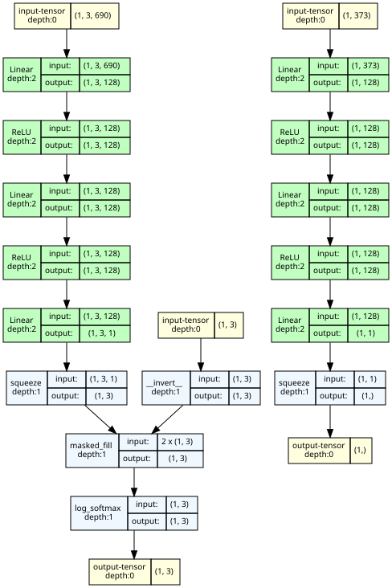

# mlp-v1

## 識別と適用範囲

model_id は mlp、モデル版は 1。旧公開入力の参加者別特徴レシピ participant-action-v1 と、既定の public_aggregate 履歴を使う PPO Actor–Critic。

## 構造と入出力

~~~mermaid
flowchart LR
    S["現在の状態と履歴集約"] --> V["Critic MLP"]
    C["候補ごとの特徴"] --> A["Actor MLP"]
    S --> C
    A --> P["候補別対数確率"]
    V --> R["状態価値"]
~~~

既定の特徴幅は候補ごとに 690、状態ごとに 373。Actor は候補内容・現在状態・履歴集約を含む候補別特徴 [B, C, 690] を使い、Critic は候補に依存しない状態特徴 [B, 373] を使う。両者はそれぞれ幅 128 の隠れ層を 2 層持つ。出力は候補別対数確率 [B, C] と状態価値 [B]。

## 順序・マスク・上限

候補軸 C は可変。候補マスク [B, C] の偽の位置を除き、候補全体で対数確率を正規化する。現在の決定の状態を使い、履歴情報は特徴として集約済み。

## 設定・互換性・検証

[代表設定](../../configs/models/mlp.toml) · [実装](../../src/gf_models/mlp/model.py) · [MLP PPO 設計](../adr/0008-mlp-ppo-generations-and-fixed-data.md) · [MLP PPO 検証](../verification/mlp-ppo.md)。 重みと特徴レシピは当該世代の推論マニフェストに対応する。

## 代表実行の図

CPU の通常 forward。B=1、候補軸 C=3 で全3件が有効。

[SVG を拡大する](mlp-v1.svg)
