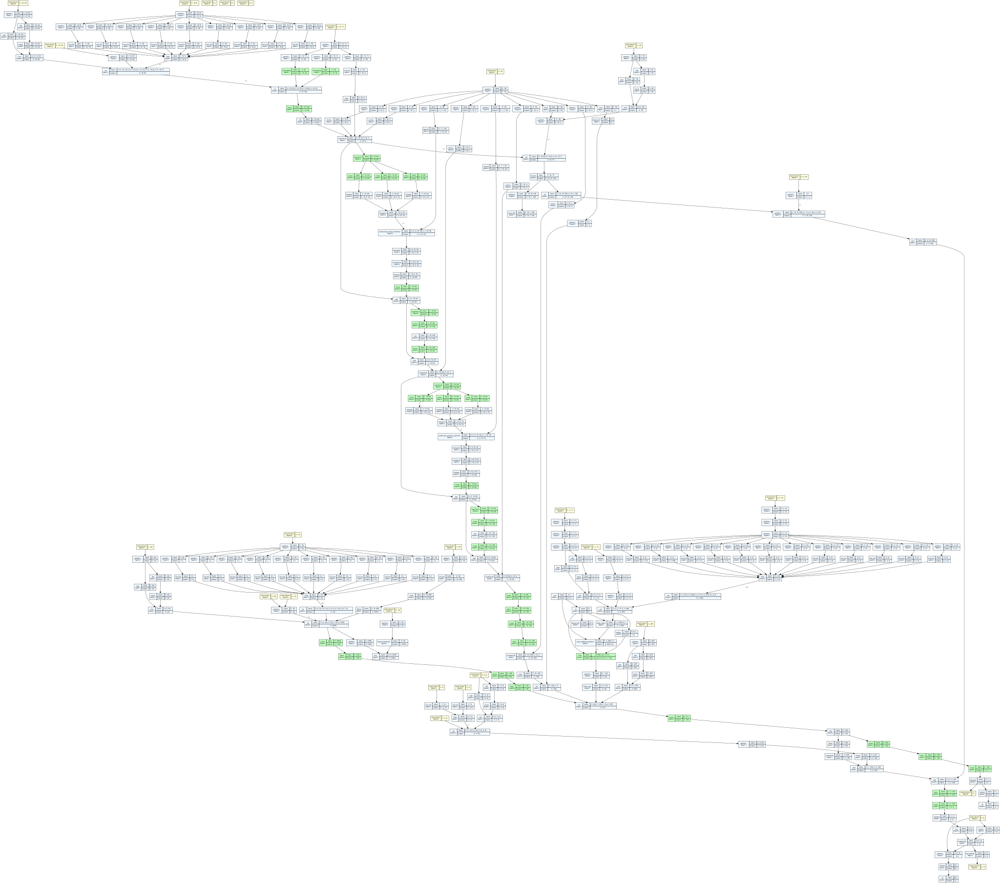

# mlp-v4-event-gru

## 識別と適用範囲

model_id は mlp、モデル版は 4、入力レシピは participant-structured-v2。訂正後の CardInstance 入力を処理する HPO 用の構造化 PPO。図は HPO 試行の上書き前の既定構成。

## 構造と入出力

~~~mermaid
flowchart LR
    S["本人の状態"] --> SM["状態 MLP"]
    H["カード 18 スロット"] --> HC["カード埋め込み・符号化"]
    HC --> HM["手札 attention と集約"]
    E["区間イベント列"] --> GR["イベント GRU"]
    SM --> F["意思決定フレーム"]
    HM --> F
    GR --> F
    G["履歴集約"] --> F
    F --> T["現在フレームの MLP"]
    T --> A["候補別 Actor MLP"]
    T --> V["Critic MLP"]
    HC -->|候補が参照したカード| A
    C["候補特徴と順序付きカード参照"] --> A
    A --> P["候補別対数確率"]
    V --> R["状態価値"]
~~~

既定では状態を 64、カードを 64、手札を 128 に符号化する。手札は 2 層・4 heads の attention とマスク付き平均を使う。区間イベントは幅 405 の行列 [E, 405] を 1 層 GRU で処理し、32 幅に要約する。履歴集約 387 と結合したフレームは 611 幅。現在のフレームだけを射影する。フレームには区間イベントの要約と履歴集約が含まれる。 Actor は候補の 26 幅の特徴と参照カードを文脈に合わせて採点する。既定の展開相当幅は 1432。 バッチの出力は候補別対数確率 [B, C] と状態価値 [B]。

## 順序・マスク・上限

手札側は固定 18 スロットで空き枠をマスクする。1 候補内のカード参照は順序を維持し、候補対数確率は同じ決定の候補全体で正規化する。区間イベントは発生順。0 件の区間はゼロ要約で、既定の区間上限は 4,096 件、履歴集約の窓は 128 件。現在行の処理に入る履歴は区間イベントと集約特徴。

## 設定・互換性・検証

新規の収束診断は Simulator v3 の Action profile を使う。霧中に攻撃者が伏せられたイベントは、既存の欠損表現と公開された対象・攻撃力で符号化する。Journal は当該対局の Action profile に結び付く。 [収束診断の設定](../../configs/hpo/mlp-256-convergence-1000.toml) · [v3 の互換性](../adr/0079-simulator-v3-direct-defense.md)

TBPTT は学習レシピに所属し、推論グラフの文脈上限とは独立。 [機能確認用 HPO 設定](../../configs/hpo/owned-mlp-smoke.toml) · [Model4 の設定と互換性](../design/ppo-hpo.md) · [PPO 更新の検証](../verification/ppo-update-adoption.md) · [共通ネットワーク実装](../../src/gf_models/structured_network.py)

## 代表実行の図

パック済みテンソルからフレーム行をインデックスで取得し、Actor と Critic に渡す eager CPU 演算。B=1、意思決定 T=1、区間イベント E=2、カード2枚／18スロット、候補 C=3。

[SVG を拡大する](mlp-v4-event-gru.svg)
