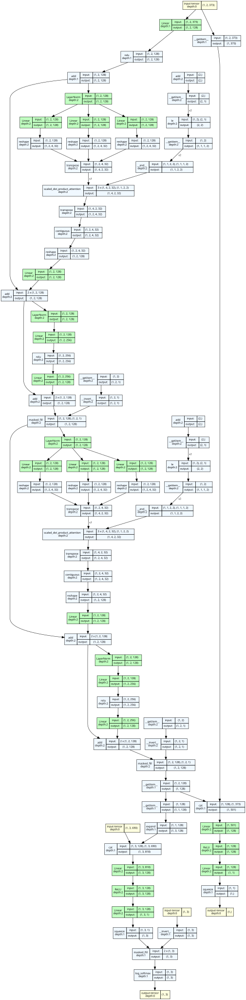

# transformer-v1

## 識別と適用範囲

model_id は transformer、モデル版は 1。旧公開入力の参加者別特徴レシピ participant-action-v1 と、既定の public_aggregate 履歴を使う PPO Actor–Critic。

## 構造と入出力

~~~mermaid
flowchart LR
    S["自分の意思決定列"] --> T["因果自己注意 2層"]
    T --> A["Actor MLP"]
    T --> V["Critic MLP"]
    S --> V
    C["現在の候補別特徴"] --> A
    S -->|現在の状態と履歴集約| C
    A --> P["候補別対数確率"]
    V --> R["状態価値"]
~~~

候補別特徴には候補内容・現在状態・履歴集約が入る。各時点の状態特徴は候補から独立している。[B, T, 373] の状態特徴を幅 128 に射影し、2 層の因果自己注意（4 heads、FFN 幅 256）で処理する。最後の文脈を候補特徴 [B, C, 690] と結合して Actor に渡し、最後の状態特徴と結合して Critic に渡す。出力は候補別対数確率 [B, C] と状態価値 [B]。

## 順序・マスク・上限

自分の意思決定を古い順に最大 1,024 件まで扱い、増分推論では層ごとの Key/Valueをキャッシュする。候補マスク [B, C] の偽の位置を除き、候補全体で対数確率を正規化する。学習の TBPTT は勾配を伝える範囲を制御する。

## 設定・互換性・検証

[代表設定](../../configs/models/transformer.toml) · [実装](../../src/gf_models/transformer/model.py) · [系列 PPO 設計](../adr/0022-gru-transformer-ppo-plan.md) · [系列 PPO 検証](../verification/sequence-ppo.md)。 重みと特徴レシピは当該世代の推論マニフェストに対応する。

## 代表実行の図

CPU の通常 forward。B=1、意思決定 T=2、候補軸 C=3 で全3件が有効。

[SVG を拡大する](transformer-v1.svg)
