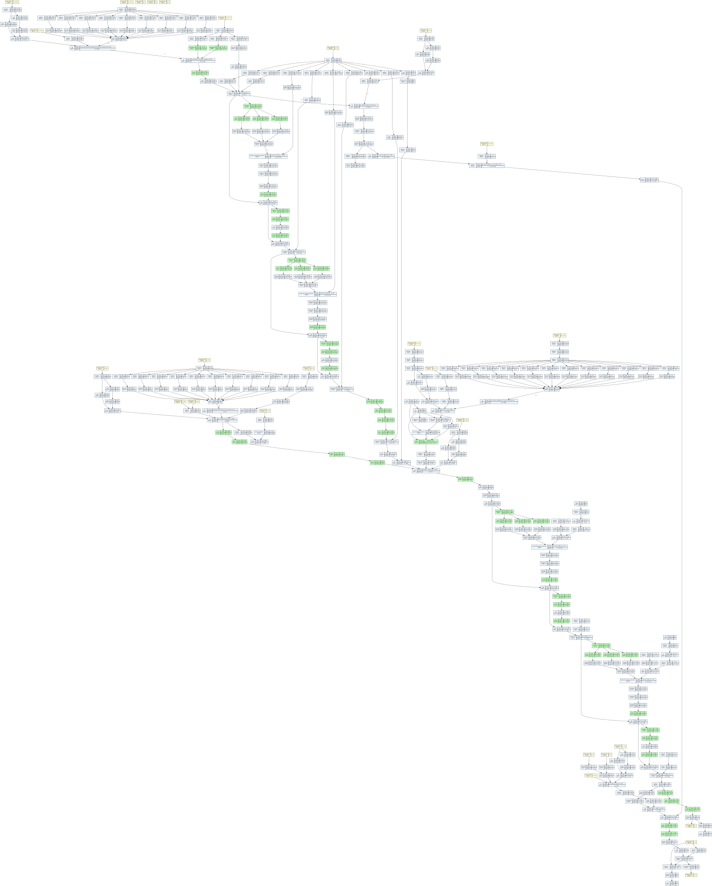

# transformer-v3-event-gru

## 識別と適用範囲

model_id は transformer、モデル版は 3、入力レシピは participant-structured-v2。CardInstance の本人観測・イベント・候補表を処理する構造化 PPO。図は訂正後の CardInstance レイアウトを使う。

## 構造と入出力

~~~mermaid
flowchart LR
    S["本人の状態"] --> SM["状態 MLP"]
    H["カード 18 スロット"] --> HC["カード埋め込み・符号化"]
    HC --> HM["手札 attention と集約"]
    E["区間イベント列"] --> GR["イベント GRU"]
    SM --> F["意思決定フレーム"]
    HM --> F
    GR --> F
    G["履歴集約"] --> F
    F --> T["意思決定 Transformer"]
    T --> A["候補別 Actor MLP"]
    T --> V["Critic MLP"]
    HC -->|候補が参照したカード| A
    C["候補特徴と順序付きカード参照"] --> A
    A --> P["候補別対数確率"]
    V --> R["状態価値"]
~~~

既定では状態を 64、カードを 64、手札を 128 に符号化する。手札は 2 層・4 heads の attention とマスク付き平均を使う。区間イベントは幅 405 の行列 [E, 405] を 1 層 GRU で処理し、32 幅に要約する。履歴集約 387 と結合したフレームは 611 幅。幅 128、2 層・4 heads・FFN 幅 256 の因果自己注意が本人のフレーム列を処理する。増分推論では Key/Value を保持する。 Actor は候補の 26 幅の特徴と参照カードを文脈に合わせて採点する。既定の展開相当幅は 1432。 バッチの出力は候補別対数確率 [B, C] と状態価値 [B]。

## 順序・マスク・上限

手札側は固定 18 スロットで空き枠をマスクする。1 候補内のカード参照は順序を維持し、候補対数確率は同じ決定の候補全体で正規化する。区間イベントは発生順。0 件の区間はゼロ要約で、既定の区間上限は 4,096 件、履歴集約の窓は 128 件。系列モデルは本人の意思決定順に最大 1,024 フレームまで扱う。

## 設定・互換性・検証

[代表設定](../../configs/models/card-instance-transformer.toml) · [CardInstance 契約と artifact](../adr/0024-card-instance-simulator-v2.md) · [移行・実行の検証](../verification/card-instance-v2-adoption.md)。 保存済み重みのレイアウトは記録済みの入力契約に従う。 [共通ネットワーク実装](../../src/gf_models/structured_network.py)。

## 代表実行の図

パック済みテンソルを使った eager CPU forward。B=1、意思決定 T=2、各区間のイベント E=2、カード2枚／18スロット、候補 C=3。

[SVG を拡大する](transformer-v3-event-gru.svg)
